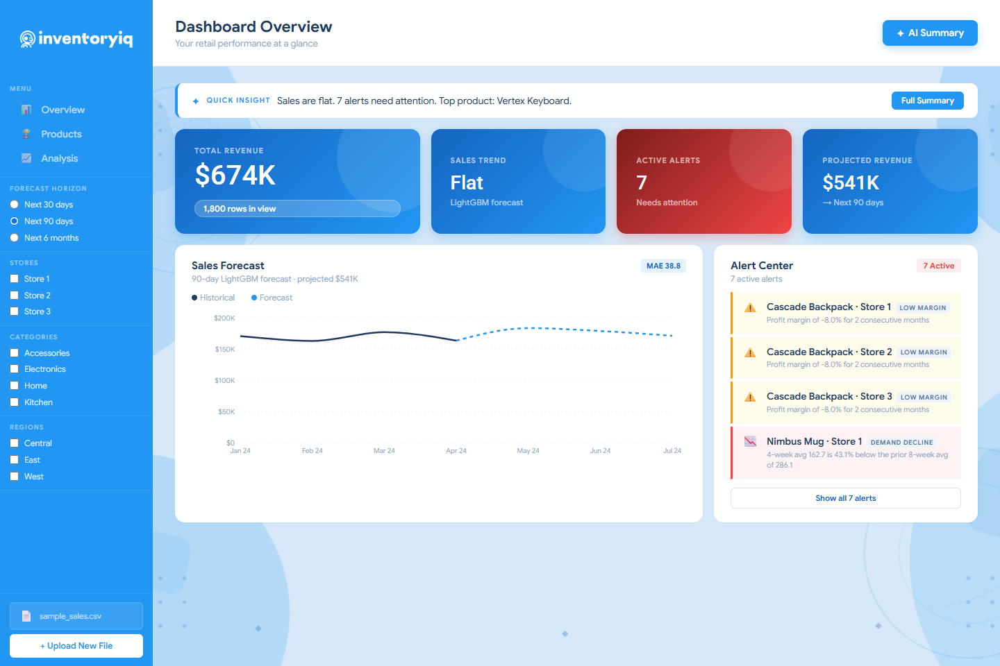
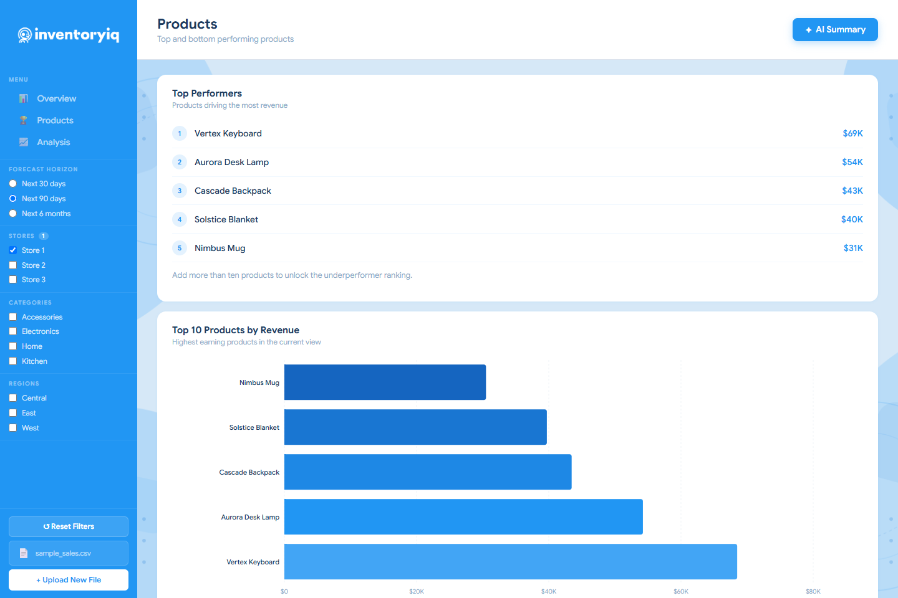
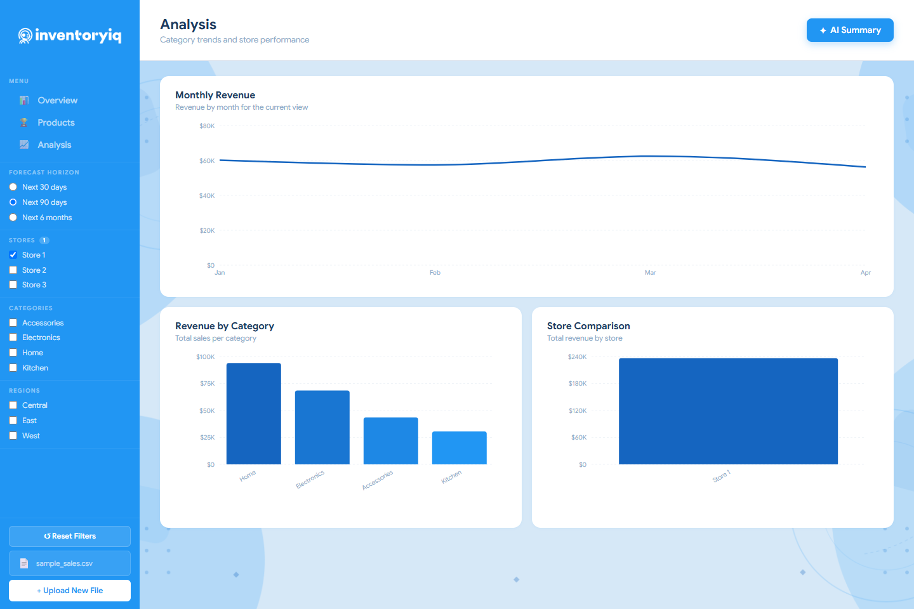
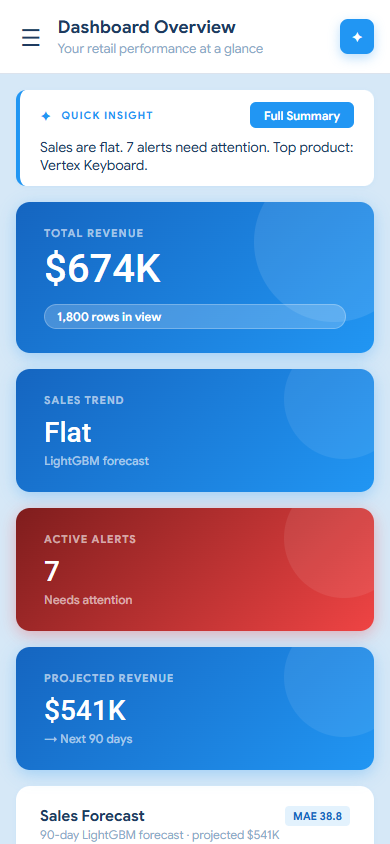

# InventoryIQ — AI-Powered Retail Forecasting Engine
LA Tech Rising | Spring 2026 | Mentor: Ritesh Verma

A reusable retail forecasting engine that ingests historical sales data, forecasts future demand, flags unusual patterns, and generates plain-English summaries using the Gemini API.

## Team

| Role | Name | Primary Ownership |
|------|------|-------------------|
| Project Lead · Architecture & Infrastructure | Mira Bhakta | System design, model selection, testing suite, CI/CD, deployment, cross-role debugging |
| Co-Project Lead · Alerting Engine · Forecasting Co-Owner | James Ybarra | `models/alerter.py`, `utils/forecasting.py` (co-owner) |
| Data Preparation & Schema Mapping · Dashboard Support | Andrew Garcia Leopold | `utils/processor.py` - schema mapping + derived fields |
| Data Preparation (Derived Fields) · AI Insights Support | Krisna Vega | `utils/trend.py` + derived fields in `processor.py` |
| Forecasting Engine · Alerting Co-Owner | Alberto Barboza | `utils/forecasting.py`, `models/alerter.py` (co-owner) |
| AI Insights & Reporting · Dashboard Support | Sarah Abdeen | `utils/ai_summary.py` + dashboard AI summary panel |
| Dashboard & Visualization · Integration Lead | Justin Hernandez | `frontend/src/pages/DashboardPage.jsx` — views, sidebar, filters, layout, loading states |


## Tech Stack

### Backend
- Python
- FastAPI
- Uvicorn
- pandas
- NumPy
- scikit-learn
- LightGBM
- Google Gen AI SDK
- python-dotenv
- openpyxl

### Frontend
- React 19
- Vite
- React Router DOM
- Axios
- Recharts

## Repository Layout

```
api/         FastAPI route layer
services/    Forecast orchestration and response shaping
models/      Alert engine
utils/       Cleaning, schema mapping, forecasting, Gemini summary
frontend/    React + Vite dashboard
data/        Small demo dataset (regenerate with scripts/)
tests/       Backend pytest suite
```

## Local Setup

### 1. Clone the repository
```bash
git clone https://github.com/mirabhakta/inventoryIQ.git
cd inventoryIQ
```

### 2. Set up the backend
Use Python 3.11 or 3.12. Python 3.14 may fail with older pinned dependencies on Windows.

```bash
python -m venv venv
```

Activate the virtual environment:

**Windows PowerShell**
```powershell
venv\Scripts\Activate.ps1
```

**macOS/Linux**
```bash
source venv/bin/activate
```

Install backend dependencies:

```bash
pip install -r requirements.txt
```

Create a `.env` file in the project root (start from the committed template):

```bash
cp .env.example .env
```

```env
GEMINI_API_KEY=your_api_key_here
```

Run the backend:

```bash
uvicorn main:app --reload
```

The backend should start at:
- `http://localhost:8000`
- API docs: `http://localhost:8000/docs`

Run the backend tests:

```bash
pip install -r requirements-dev.txt
pytest
```

### 3. Set up the frontend

Open a second terminal and run:

```bash
cd frontend
npm ci
npm run dev
```

The frontend should start at:
- `http://localhost:5173`

If the API is not running on `localhost:8000`, copy `frontend/.env.example` to
`frontend/.env.local` and change `VITE_API_BASE_URL`.

## Running the App

You need two terminals:

1. **Backend**
```bash
uvicorn main:app --reload
```

2. **Frontend**
```bash
cd frontend
npm run dev
```

## Try the Demo

Upload **`data/sample_sales.csv`** on the upload page. It contains 1,800 rows
across three stores and five products, with a planted demand decline, a
low-margin product, and a one-day sales spike so the dashboard and alert panel
have real signals to show.

Regenerate it at any time with:

```bash
python scripts/generate_sample_data.py
```

## Features
- Upload retail CSV or Excel (`.xlsx`) files up to 10 MB / 50,000 rows
- Fuzzy schema mapping for common column names (`OrderDate`, `Sales Amnt`, `Units_Sold`…)
- LightGBM demand forecasts for 30, 90, or 180 days, benchmarked against naive, rolling-average, and ridge baselines
- Model comparison with MAE, RMSE, and MASE on a time-based holdout
- Store-level alerts for sales anomalies, demand declines, and margin losses
- Plain-English Gemini summary on demand; the app stays fully usable without a key
- Server-side filters by store, category, region, and forecast horizon

## How It Works

1. `POST /analyze` decodes the upload, maps columns to the shared schema, applies filters, and returns KPIs, monthly history, product/store/category rankings, an aggregated forecast, alerts, and the model benchmark in one response.
2. The React dashboard renders that payload directly. Changing a filter re-runs `/analyze` with the same file, and in-flight requests are cancelled so stale responses never win.
3. `POST /summary` sends the current metrics to Gemini only when the user asks for a summary.

## Screenshots



| Products | Analysis |
| --- | --- |
|  |  |

<p align="center">
  
</p>

## Security
Never commit your `.env` file. It is excluded from version control via `.gitignore`.
Start from `.env.example` instead. If a key is accidentally exposed, revoke it
immediately in the Gemini console and generate a new one.

The AI summary is optional. Without `GEMINI_API_KEY`, the dashboard shows a clear
configuration message instead of failing.

## License

MIT — see [LICENSE](LICENSE).
